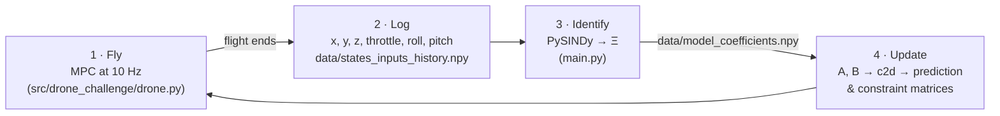

# Self-tuning drone MPC: PySINDy system identification + model predictive control

**[▶ Try the interactive demo](https://sebzuddas.github.io/london_drone_stability/)**: fly the drone to any point in 3D, add wind, and watch the model re-learn itself as the drone wears.

Built during a London drone-control hackathon (May 2025).

The idea: instead of hand-tuning a PID loop or deriving equations of motion, **learn the drone's dynamics from its own flight logs** and give that learned model to a **model predictive controller (MPC)**. The identification step runs again after every flight, so the model the MPC plans with follows the drone as it changes. Motor wear, battery sag and slow sensor drift get absorbed into the next model instead of building up as tracking error.



---

## The challenge

The organisers ran a drone simulator behind a gRPC server ([`proto/drone.proto`](proto/drone.proto)):

- the server streams the drone's **position** (`x, y, z`) at 10 Hz, plus a **goal region** and an arena **boundary** at the start;
- the client sends back integer **`throttle`, `roll`, `pitch`** commands;
- the flight ends when the drone reaches the goal, crashes, or leaves the arena.

No equations of motion are given. You only see positions in and commands out.

## What I built

### 1 · System identification with PySINDy (`main.py`)

[SINDy](https://pysindy.readthedocs.io/) (Sparse Identification of Nonlinear Dynamics) models the dynamics as a sparse combination of candidate functions of state and input:

$$\dot{x} = \Xi^\top \theta(x, u)$$

Each flight log (`[x, y, z, throttle, roll, pitch]` every 100 ms) goes into PySINDy with:

- `ps.IdentityLibrary()`: candidate terms are the states and inputs themselves, so the result is a **linear state-space model** $\dot{x} = Ax + Bu$;
- `ps.STLSQ`: sequentially thresholded least squares;
- states `x, y, z`, controls `throttle, roll, pitch`.

The coefficient matrix splits into `A = Ξ[:, :3]` and `B = Ξ[:, 3:]` and is saved to `data/model_coefficients.npy`.

Models identified from two real flights in the hackathon simulator (`data/saved data/`), rows = $\dot x, \dot y, \dot z$:

| flight | | x | y | z | throttle | roll | pitch |
|---|---|---|---|---|---|---|---|
| v1 (1133 samples) | ẋ | −4.6e-5 | 6.4e-4 | 6.5e-2 | 6.2e-6 | −6.1e-4 | −3.4e-4 |
| | ẏ | −4.1e-4 | 1.0e-3 | 1.0e-1 | 2.4e-4 | −1.3e-2 | 2.6e-4 |
| | ż | 2.9e-4 | −4.0e-4 | 3.2e-3 | −4.3e-5 | 1.9e-3 | −9.1e-4 |
| v2 (435 samples) | ẋ | 3.5e-3 | −4.2e-3 | −6.6e-2 | 2.8e-3 | −1.9e-3 | −1.5e-3 |
| | ẏ | −2.9e-3 | 3.2e-4 | 2.5e-1 | 2.6e-3 | −3.0e-3 | −2.4e-3 |
| | ż | 5.9e-3 | −3.7e-3 | −8.8e-3 | 1.2e-4 | 1.1e-3 | −6.6e-4 |

The two models differ noticeably, which is the point. Each flight sees a slightly different drone and different excitation, and the controller should plan with the most recent one.

### 2 · Model predictive control (`src/drone_challenge/drone.py`, `main.py`)

The MPC is written from scratch on top of `numpy`, `python-control` and `quadprog`:

1. **Discretise** the identified model at the control period (`control.matlab.c2d`).
2. **Terminal cost**: place closed-loop poles to get a stabilising gain $K$, then solve the discrete Lyapunov equation $(A+BK)^\top P (A+BK) - P = -(Q + K^\top R K)$ for $P$.
3. **Condensed prediction matrices**: $X = F x_0 + G U$ over horizon $N$ (`predict_mats`).
4. **Cost matrices**: $H = 2(G^\top \bar Q G + \bar R)$, $L = 2 G^\top \bar Q F$ (`cost_mats`), with $\bar Q = \mathrm{blkdiag}(Q, \dots, Q, P)$.
5. **Constraints**: input bounds (throttle, ±45° roll/pitch) and state bounds (the arena box) stacked over the horizon and rewritten in terms of $U$ (`constraint_mats_2`).
6. **Every tick**: solve the QP $\min_U \tfrac12 U^\top H U + (L(x_\text{ref} - x))^\top U$ s.t. $P_c U \le q_c + S_c x$ with `quadprog.solve_qp`, apply the first input, repeat (receding horizon).

`drone.py` loads the latest coefficients at start-up, connects to the simulator over gRPC, runs this loop on every position update, and writes the flight's state/input history to `data/states_inputs_history.npy` when the simulation ends.

### 3 · The learning loop: refit after every flight

```
python src/drone_challenge/drone.py   # fly with the current model, log states + inputs
python main.py                        # PySINDy refit on that log → data/model_coefficients.npy
python src/drone_challenge/drone.py   # next flight plans with the updated model
```

**Why bother?** A model identified once slowly goes wrong. Batteries and motors lose thrust, the IMU's idea of "level" drifts, props get damaged. An MPC is only as good as its prediction model: with stale gains it under- or over-corrects, and with a stale hover point it settles off-target. Re-running identification after every flight keeps the model matched to the drone you actually have, with no manual retuning.

---

## The interactive demo (`docs/`)

The GitHub Pages site re-implements the same pipeline in plain JavaScript so it runs entirely in the browser, on desktop or phone:

- **3D view** (three.js) of a simulated quadrotor in a 40 × 40 × 18 m arena, with live wind streaks, the flown path and the **MPC's planned trajectory**;
- **set a target** by tapping the ground or typing X/Y/Z; the MPC flies there;
- **wind**: mean speed, direction and gustiness;
- **learning loop**: a calibration flight identifies model v1 with SINDy. After every flight, the log is refit and the new model is swapped in. The coefficient table and a "real drone vs. model" panel show it tracking the drone as it wears.
- **toggles to break it**: turn off refitting and/or the disturbance estimator and watch the model error and the settling offset grow.

Differences from the hackathon code, made so a single-page demo stays stable without a person tuning it:

| | Hackathon (`drone.py`) | Demo (`docs/js/core.js`) |
|---|---|---|
| States | position (3) | position + velocity (6), velocity estimated from positions |
| Library | identity | identity + constant, with a physics mask (no position terms, drag on own axis) |
| Refit | full refit on last flight | regularised towards the previous model, accepted only if it beats it on held-out data |
| QP solver | `quadprog`, input + state constraints, Lyapunov terminal cost | accelerated projected gradient (FISTA), input bounds, weighted terminal cost |
| Disturbances | none | offset-free disturbance estimator for wind |

Run the numerical core headless (identification accuracy, waypoint tracking in gusty wind, refit vs. frozen under drift):

```bash
node docs/test/core.test.mjs
```

Preview the site locally:

```bash
cd docs && python3 -m http.server 8000   # → http://localhost:8000
```

**Publishing:** in the repo's *Settings → Pages*, set the source to *Deploy from a branch*, branch `main`, folder `/docs`.

---

## Repository layout

```
src/drone_challenge/drone.py   gRPC client: loads the SINDy model, runs the constrained MPC, logs the flight
main.py                        PySINDy identification from the latest log + offline MPC simulation/plots
constrained.py                 earlier pure-linear-algebra constrained MPC prototype (power-grid frequency example)
droneSimulator.py              synthetic data generator used to test the SINDy setup before the hackathon
proto/drone.proto              simulator protocol (from the organisers)
data/                          flight logs and identified coefficients (saved data/ = real flights v1, v2)
docs/                          GitHub Pages demo (index.html, css/, js/core.js, js/app.js, test/)
```

## Running the Python side

```bash
conda env create -f environment.yml && conda activate london_drone_env   # or: poetry install
scripts/generate_proto.sh                                                # gRPC bindings → src/drone_challenge/generated
```

Then run the loop above. The simulator host/port/token in `drone.py` belong to the hackathon server, which may no longer be running. The offline path (`python main.py`) works on the saved logs.

## Limitations & next steps

- The loop is two scripts run back to back; a small runner that flies, refits, validates and promotes the model would make it hands-off.
- The 3-state position model treats inputs as velocity commands. Adding velocity states (as in the demo) captures acceleration dynamics and wind much better.
- Closed-loop data is poorly excited. Small input dither, a prior on the previous model, and a held-out validation gate (all in the demo) make refits much safer.
